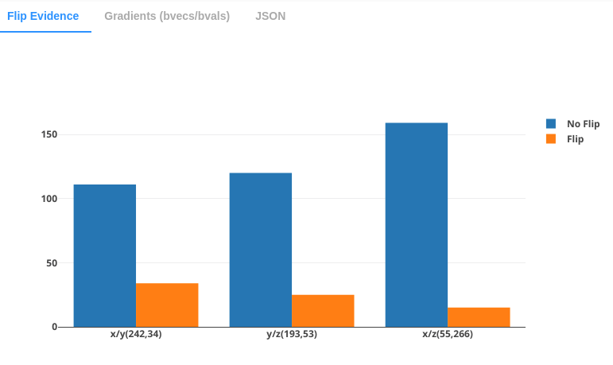
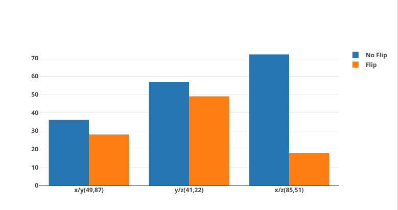
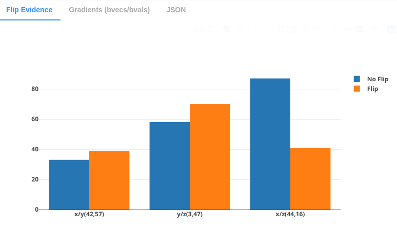
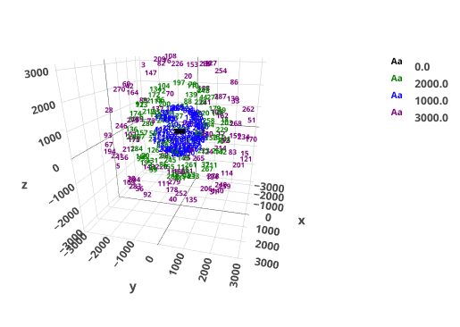

<h1 align="center">Check Gradient Flip</h1>

<p align="center">
  Checks whether DWI bvecs need to be flipped along x, y or z by comparing slice-wise diffusion signal directionality with the gradient directions, using DIPY and NiBabel.
</p>

<p align="center">
  <a href="https://github.com/brainlife/abcd-spec"></a>
  <a href="https://doi.org/10.25663/bl.app.85"></a>
  <a href="https://github.com/brainlife/app-testflip/blob/master/LICENSE"></a>
</p>

> **This branch, `1.3`, is the brainlife.io App Check Gradient Flip** ([doi:10.25663/bl.app.85](https://doi.org/10.25663/bl.app.85)).

## At a glance

<!-- brainlife-app:begin (generated from the App manifest; edit the manifest, not this block) -->

> **Checks whether DWI bvecs need to be flipped along x, y or z by comparing slice-wise diffusion signal directionality with the gradient directions, using DIPY and NiBabel.**

Reads the DWI, bvals and bvecs, selects volumes whose gradients point along diagonal directions and compares the signal in each slice to detect whether the bvec polarity is consistent with the image, reporting the result and image header information in product.json. Use it as a quick QC check before tensor fitting or tractography; incorrect bvec polarity leads to wrong fibre orientations. It does not modify the data.

| | |
|---|---|
| **Inputs** | `neuro/dwi` |
| **Container** | `brainlife/dipy:1.1.1` |
| **Resources** | 1 CPUs |
| **Run it** | [doi.org/10.25663/bl.app.85](https://doi.org/10.25663/bl.app.85) |

#### Inputs

| Input | Datatype | Required | Description |
|---|---|---|---|
| `dwi` | `neuro/dwi` | yes | Diffusion-weighted image with bvals and bvecs to check. |

<!-- brainlife-app:end -->

## Running the App

### On brainlife.io

Open the App at [doi.org/10.25663/bl.app.85](https://doi.org/10.25663/bl.app.85), choose `neuro/dwi` from your project and press **Execute**.

### Locally

You need [Singularity/Apptainer](https://apptainer.org/) (the App runs in `brainlife/dipy:1.1.1`), [`jq`](https://jqlang.github.io/jq/).

1. Clone this repository.
2. Create `config.json` with the paths to your inputs and the parameters:

   ```json
   {
       "dwi": "/path/to/dwi/dwi",
       "bvecs": "/path/to/dwi/bvecs",
       "bvals": "/path/to/dwi/bvals"
   }
   ```

3. Run `./main`.

## Sample Datasets

If you don't have your own input file, you can download sample datasets from Brainlife.io, or you can use [Brainlife CLI](https://github.com/brainlife/cli).

```
npm install -g brainlife
bl login
mkdir input
bl dataset download 5a050a00eec2b300611abff3 && mv 5a050a00eec2b300611abff3 input/dwi
```

## Example of output from high SNR image



This plot shows that most slices has very low evidence of no flip.

## Example of output from low SNR / low quality image.



This plot shows that the image does not seem to be flipped, however, X/Y and Y/Z are close to being inconclusive. The image might be blurry, or has low SNR.

## Example of output from y-flipped image.



This plot shows that x/y, y/z are flipped. Since the common axis on x/y and y/z are y, we conclude that y axis is flipped in bvecs. However the flip evidence is close to inconclusiv. The image might be blurry, or has low SNR.

## Other Outputs

This App also generates plotly graphs showing the arrangements of gradient vectors.



## Citing

If you use this App, please cite it, the software it builds on and brainlife.io:

- Check Gradient Flip. brainlife.io App. [doi:10.25663/bl.app.85](https://doi.org/10.25663/bl.app.85)
- Garyfallidis et al. Dipy, a library for the analysis of diffusion MRI data. *Frontiers in Neuroinformatics* 8 (2014). [doi:10.3389/fninf.2014.00008](https://doi.org/10.3389/fninf.2014.00008)
- Hayashi S, Caron BA, Heinsfeld AS, et al. brainlife.io: a decentralized and open-source cloud platform to support neuroscience research. *Nature Methods* 21:809–813 (2024). [doi:10.1038/s41592-024-02237-2](https://doi.org/10.1038/s41592-024-02237-2)
- Avesani P, McPherson B, Hayashi S, et al. The open diffusion data derivatives, brain data upcycling via integrated publishing of derivatives and reproducible open cloud services. *Scientific Data* 6:69 (2019). [doi:10.1038/s41597-019-0073-y](https://doi.org/10.1038/s41597-019-0073-y)

## Authors

- Soichi Hayashi

**Project directors**

- Franco Pestilli ([@francopestilli](https://github.com/francopestilli))

## Funding

[](https://wellcome.org/)
[](https://reporter.nih.gov/project-details/11261037)
[](https://reporter.nih.gov/project-details/11411328)
[](https://reporter.nih.gov/project-details/10262925)
[](https://reporter.nih.gov/project-details/10428625)
[](https://reporter.nih.gov/project-details/10460628)
[](https://reporter.nih.gov/project-details/11140284)
[](https://www.nsf.gov/awardsearch/showAward?AWD_ID=1734853)
[](https://www.nsf.gov/awardsearch/showAward?AWD_ID=2203524)
[](https://www.nsf.gov/awardsearch/showAward?AWD_ID=1636893)
[](https://www.nsf.gov/awardsearch/showAward?AWD_ID=2148729)
[](https://www.nsf.gov/awardsearch/showAward?AWD_ID=1912270)
[](https://www.nsf.gov/awardsearch/showAward?AWD_ID=2148700)
[](https://www.nsf.gov/awardsearch/showAward?AWD_ID=1916518)

<sub>brainlife.io is publicly funded, and acknowledging that support helps keep it running. This App was developed with support from Wellcome, the U.S. National Institutes of Health (including the BRAIN Initiative BRAIN CONNECTS program: The Axonal Projectome EXchange, U24NS140384, and the Center for Mesoscale Connectomics, UM1NS132207) and the U.S. National Science Foundation.</sub>

## License

See [LICENSE](https://github.com/brainlife/app-testflip/blob/master/LICENSE).
